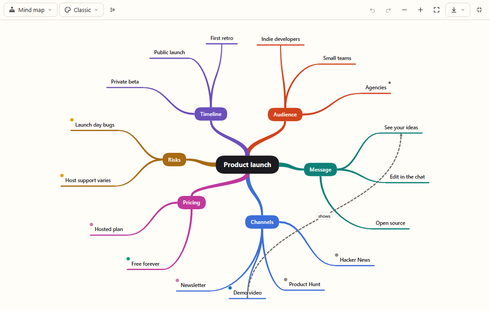
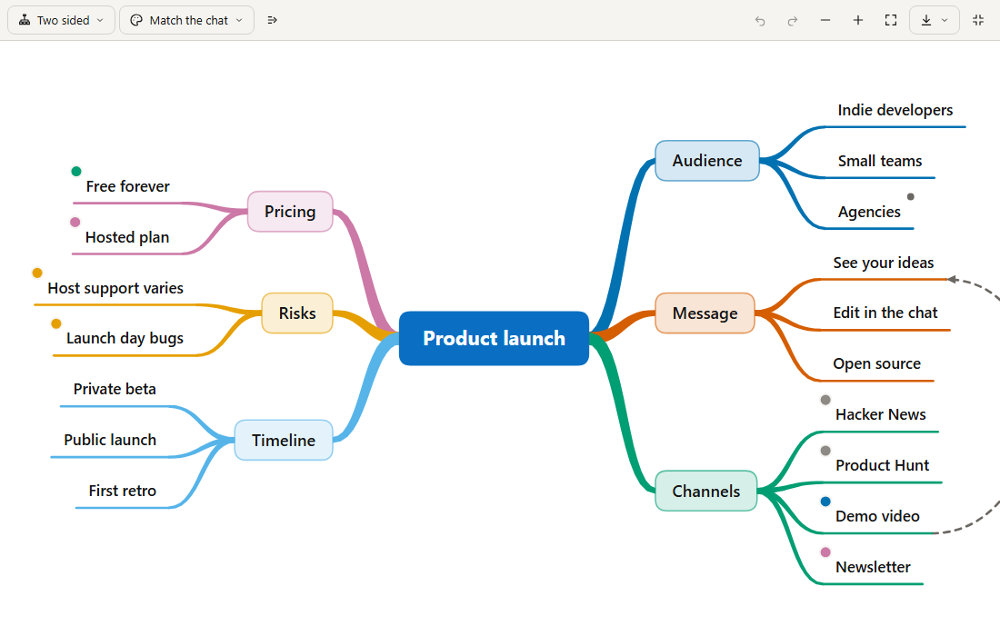
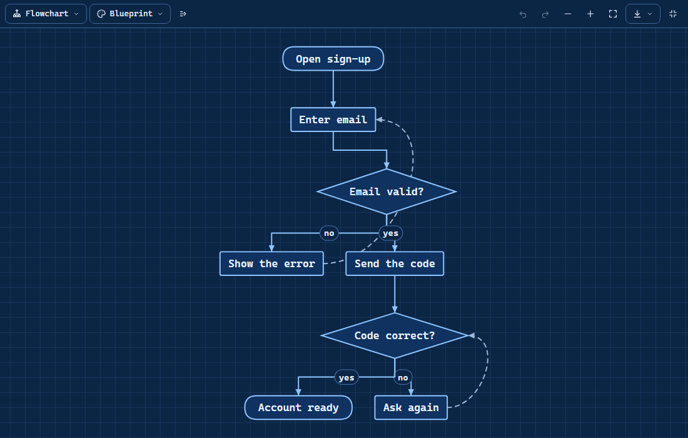
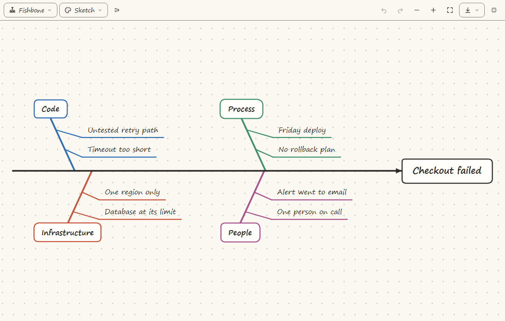
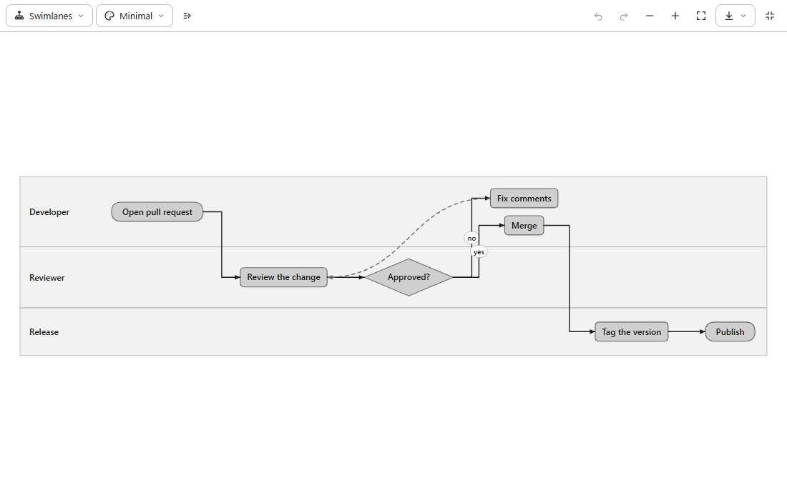
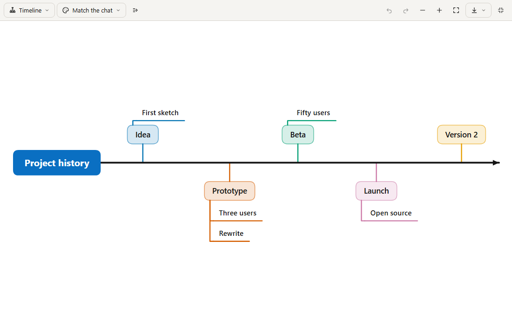

# Mind Map MCP

**Mind maps and flowcharts in your AI chat.** When an answer would be a long list or a wall of tickets, the AI draws it as a diagram instead. You restyle it, edit it and comment on it, and the AI is told what you did.


[Watch the full demo (67 seconds)](docs/demo.mp4). The demo runs the real app in a stand-in chat with scripted replies; see [demo/](demo/).

Mind Map MCP is an [MCP App](https://modelcontextprotocol.io): a server that gives an AI client tools, plus a view the client shows inside the conversation. It is built on the [PlugMCP framework](https://github.com/plugmcp-ai/plugmcp-framework), is MIT licensed, and keeps your diagrams on your own computer.

## Why

Reading a long answer means holding its structure in your head. A diagram puts the structure on the screen: what belongs together, what follows what, what is missing. See [docs/RESEARCH.md](docs/RESEARCH.md) for the evidence and the design rules that follow from it.

Other diagram tools for AI have the model place every shape by coordinates. Here the model sends only **ideas and how they connect**. The app works out the drawing. That is why you can switch the same content between nine structures and six styles with one click and no new request to the AI.

## What you can do

- **Ask for a diagram.** "Break this plan down as a mind map." "Show the sign-up flow as a flowchart." "Why did checkout fail? Use a fishbone."
- **Switch the structure.** Mind map, two sided, logic chart, org chart, outline, timeline, fishbone, flowchart, swimlanes.
- **Switch the style.** Match the chat, classic, minimal, blueprint, sketch, high contrast. Light and dark.
- **Turn animation on or off.** New nodes grow out of their parent and layouts glide into place. It follows your system's reduced motion setting.
- **Edit on the canvas.** Double-click to rename, drag a node onto another to move it, Tab for a child, Enter for a sibling, Delete to remove, Ctrl+Z to undo.
- **Talk to the AI through the diagram.** Select a node and press Explain, Expand, Break down, Challenge or To tasks, ask your own question, or leave comments and send them together. The AI answers by changing the same diagram.
- **Export.** PNG, SVG, a Markdown outline, or the data as JSON.

| | | |
|---|---|---|
|  |  |  |
|  |  |  |

Every structure in every style: [docs/gallery](docs/gallery/README.md).

## Install

> **The npm package is being published.** If `npx mindmap-mcp` is not found yet, use [From source](#from-source).

Mind Map runs on your computer with Node 20.19 or newer. Add it to your AI client:

**Claude Desktop**, in `claude_desktop_config.json`, and **Cursor**, in `.cursor/mcp.json`:

```json
{
  "mcpServers": {
    "mindmap": { "command": "npx", "args": ["-y", "mindmap-mcp"] }
  }
}
```

**VS Code**, in `.vscode/mcp.json`:

```json
{
  "servers": {
    "mindmap": { "command": "npx", "args": ["-y", "mindmap-mcp"] }
  }
}
```

**Claude Code**:

```sh
claude mcp add mindmap -- npx -y mindmap-mcp
```

On Windows, if the client cannot start `npx`, use `"command": "cmd"` with `"args": ["/c", "npx", "-y", "mindmap-mcp"]`.

### From source

```sh
git clone https://github.com/plugmcp-ai/mindmap-mcp.git
cd mindmap-mcp
pnpm install
pnpm build
```

Then point your client at the built server: `"command": "node"`, `"args": ["/full/path/to/mindmap-mcp/bin/mindmap.js"]`.

### Which clients work

| Client | Diagram in the chat | Notes |
|---|---|---|
| Claude Desktop | Yes | Inline and full screen. |
| Cursor | Yes | |
| VS Code (Copilot) | Yes | Inline only. A message from the diagram lands in the message box; press Enter to send it. |
| Claude Code and other text-only clients | No | The AI still gets the diagram as an indented outline, and can read and edit it. |
| claude.ai on the web, ChatGPT | Needs a hosted server | These accept remote servers only. See below. |

This table comes from each client's documentation. What has been tested on a real client so far, and what has not, is in [docs/HOSTS.md](docs/HOSTS.md).

**Hosting it yourself.** `mindmap-mcp --http` serves MCP at `http://127.0.0.1:3333/mcp`. To accept other computers, set `MINDMAP_ALLOWED_HOSTS` to the host names you serve and put it behind HTTPS. There is no sign-in: anyone who can reach the address can read and change every diagram, so do not expose it to the internet as it is.

## Where your diagrams live

Each diagram is one JSON file in `~/.plugmcp/mindmap/`. Set `MINDMAP_DIR` to keep them somewhere else. Nothing is sent anywhere: the server makes no network calls, and the view loads nothing from outside.

## How it works

```
You ask  ->  the AI calls visualize  ->  the diagram appears in the chat
                                              |
     you edit, comment or press a node action |
                                              v
the AI is told  ->  the AI calls edit_diagram  ->  the same diagram updates
```

| Tool | Who calls it | What it does |
|---|---|---|
| `visualize` | the AI | Makes a diagram from nodes and how they connect, or shows one again. |
| `edit_diagram` | the AI | Changes a diagram that is on screen: add, rename, move, remove, link. |
| `get_diagram` | the AI | Reads a diagram as an outline, with your comments and what you changed. |
| `load_state`, `save_state`, `export` | the view only | Keep the view and the saved file in step. The AI never sees these. |

More in [docs/ARCHITECTURE.md](docs/ARCHITECTURE.md).

## Contributing

A new style is one file of colors. A new structure is one function that places boxes. Both show up in the toolbar and the gallery, and the tests check them for you. Start with [CONTRIBUTING.md](CONTRIBUTING.md).

```sh
pnpm install
pnpm dev          # the PlugMCP Studio, with a chat to try the tools
pnpm test         # unit tests
pnpm test:e2e     # the whole loop in a real browser
pnpm gallery      # redraw docs/gallery
pnpm demo         # re-record docs/demo.mp4 and docs/demo.gif (needs ffmpeg)
```

## License

MIT. See [LICENSE](LICENSE).
